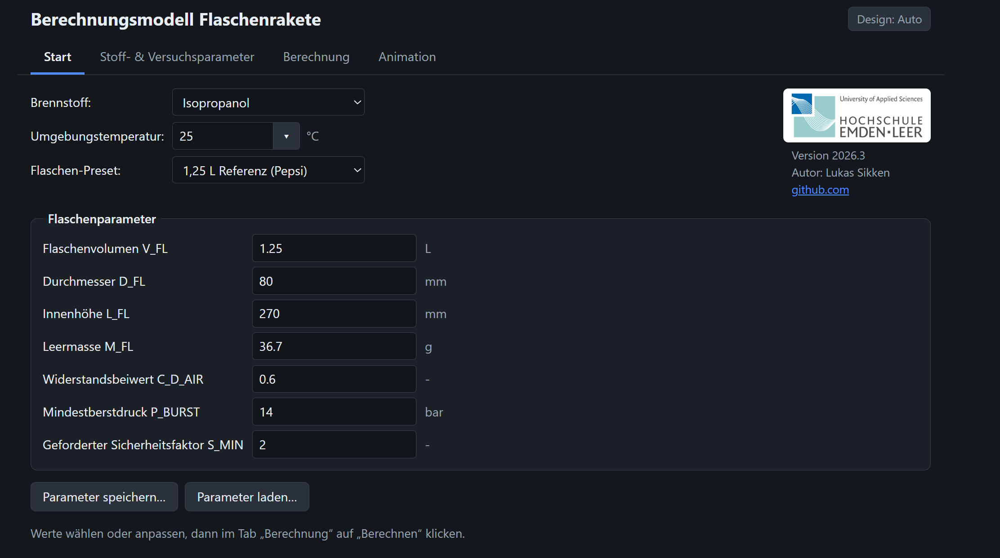
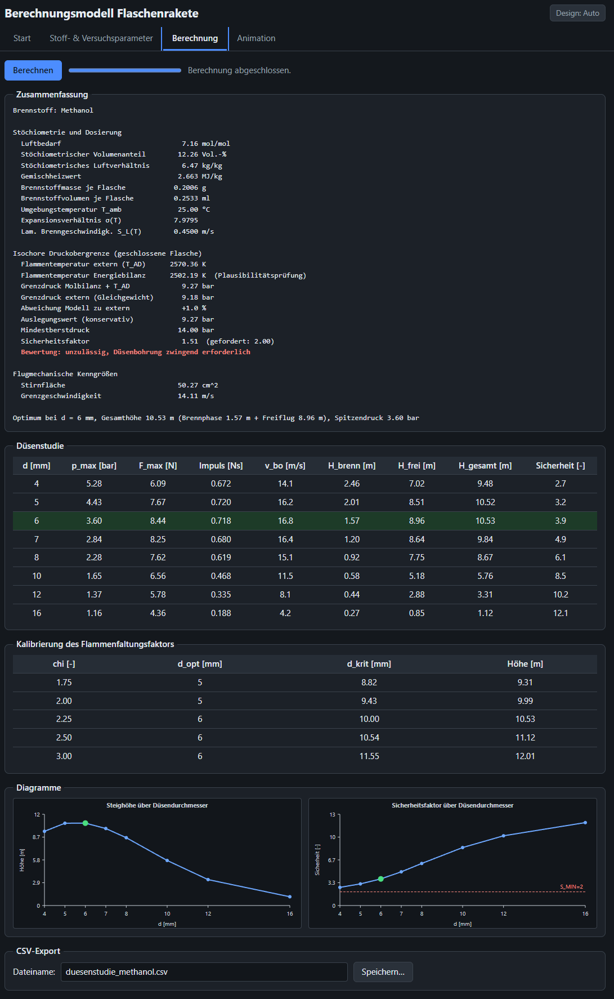
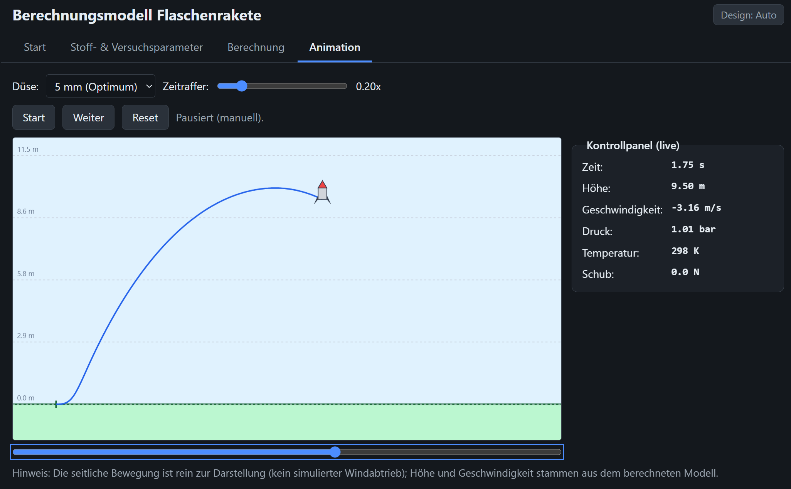
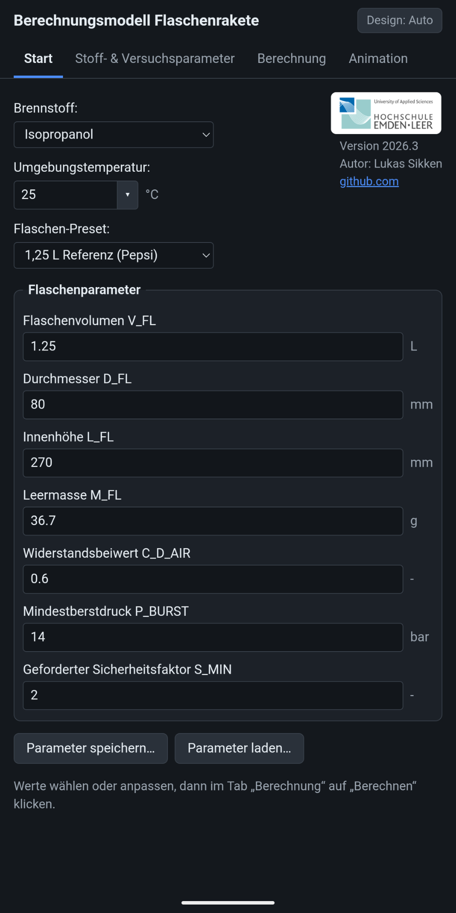
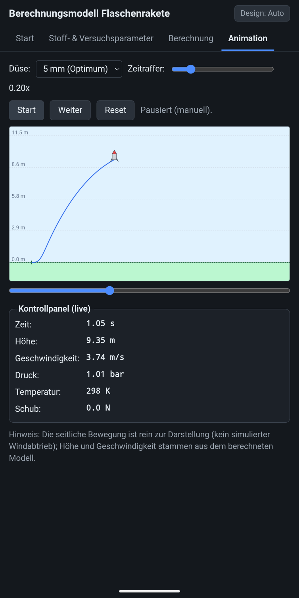

# Berechnungsmodell Flaschenrakete

Browser-Anwendung zur Berechnung und Simulation einer Flaschenrakete aus einer PET-Flasche, die mit einem Alkohol-Luft-Gemisch betrieben wird. Das Programm läuft lokal im Browser, es ist weder eine Installation noch eine Internetverbindung nötig.



## Was das Programm kann

- Berechnet für einen Brennstoff (Isopropanol, Methanol oder Ethanol) und eine PET-Flasche die erreichbare Flughöhe.
- Berechnet Druck, Temperatur und Schub während der Verbrennung und prüft den Druck gegen den Berstdruck der Flasche (Sicherheitsfaktor).
- Bestimmt den optimalen Düsendurchmesser und zeigt die Flughöhe in Abhängigkeit vom Düsendurchmesser.
- Zeigt den Flug als Animation mit Live-Werten für Höhe, Geschwindigkeit, Druck, Temperatur und Schub.
- Bietet Voreinstellungen (Presets) für die Brennstoffe und vier Flaschen. Alle Parameter lassen sich einzeln ändern.
- Gültig für Umgebungstemperaturen von 15 bis 35 °C.
- Speichert und lädt Parametersätze als JSON-Datei und exportiert die Düsenstudie als CSV-Datei.
- Hell-, Dunkel- und Auto-Darstellung. Die Oberfläche passt sich Smartphone-Bildschirmen an.

## Download und Start

### Computer (Windows, macOS, Linux)

1. Die Datei [`Flaschenrakete-HTML.zip`](Flaschenrakete-HTML.zip) herunterladen (Schaltfläche „Download raw file“ auf der Dateiseite).
2. Die ZIP-Datei **vollständig entpacken**.
3. Im entpackten Ordner die Datei `START.html` per Doppelklick öffnen. Das Programm öffnet sich im Standardbrowser.

`START.html` und der Ordner `programm` müssen zusammenbleiben. Der Ordner `programm` muss nicht geöffnet werden.

### Android

Android öffnet keine Skripte aus anderen Ordnern. Deshalb gibt es eine Variante, die alle Programmteile in **einer einzigen HTML-Datei** enthält.

1. Die Datei [`Flaschenrakete-Android.html`](Android/Flaschenrakete-Android.html) herunterladen (Schaltfläche „Download raw file“).
2. Die heruntergeladene Datei auf dem Smartphone öffnen, z. B. über die Dateien-App im Ordner „Downloads“, und mit Google Chrome öffnen.

Die Android-Version verhält sich sonst wie die Version für den Computer.

### Voraussetzung

Ein Browser mit aktiviertem JavaScript.

## Bedienung

Die Oberfläche hat vier Tabs, die in dieser Reihenfolge bearbeitet werden:

| Tab | Funktion |
|---|---|
| **Start** | Brennstoff, Umgebungstemperatur und Flasche wählen |
| **Stoff- & Versuchsparameter** | Alle Eingangsgrößen einsehen und bei Bedarf ändern |
| **Berechnung** | Rechnung starten, Ergebnisse und Diagramme ansehen, Düsenstudie als CSV exportieren |
| **Animation** | Flug der Flasche für einen gewählten Düsendurchmesser abspielen |

Das ausführliche **Benutzerhandbuch** öffnet sich im Programm über den Button mit dem **Fragezeichen (?)**. Es beschreibt alle Bedienelemente, Parameter und Abläufe.

### Berechnung



### Animation



### Mobile Ansicht

<table>
  <tr>
    <td align="center"><br>Tab „Start“</td>
    <td align="center"><br>Tab „Animation“</td>
  </tr>
</table>

## Hinweise zur Verwendung

- Das Modell ist nulldimensional. Es bildet weder Flammenausbreitung noch Druckwellen ab und liefert Prognosen, keine Messwerte.
- Das Modell setzt ein stöchiometrisches Gemisch voraus. Am belastbarsten ist es im Bereich um 18 bis 26 °C.
- Die Flugstabilität der Flasche wird nicht abgebildet. Für instabil fliegende Flaschen sind die berechneten Höhen Obergrenzen.
- Das Programm ersetzt keine sicherheitstechnische Freigabe eines Versuchs. Experimente mit brennbaren Gemischen in Druckbehältern sind gefährlich und dürfen nur mit geeigneten Schutzmaßnahmen durchgeführt werden.

## Inhalt dieses Repositories

```
├── LICENSE                           GNU General Public License v3.0
├── Flaschenrakete-HTML.zip           Version für den Computer (Ordner mit START.html)
├── Android/
│   └── Flaschenrakete-Android.html   Version für Android (eine einzelne Datei)
└── screenshots/                      Bilder für diese Seite
```

## Lizenz

Dieses Programm steht unter der [GNU General Public License v3.0](LICENSE).

## Autor

Lukas Sikken, Hochschule Emden/Leer, Fachbereich Technik, Abteilung Maschinenbau.
